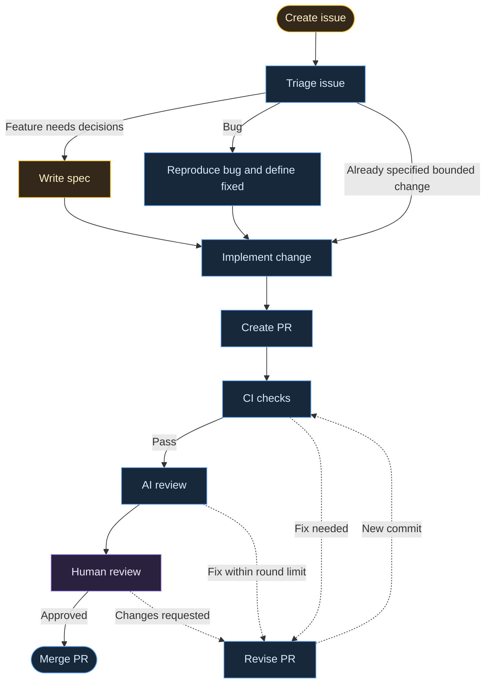

# Software factory: request to merged PR

A human works with an agent to create an issue from a feature request or bug report. Issue creation triggers intake. Triage decides whether the issue proceeds. A run that proceeds creates one pull request (PR) and uses that PR for every revision. Required checks and human approval control merge. AI review is advisory.

Solid lines show the happy path. Dotted lines show revisions on the same PR. Each new commit restarts CI.

Linked skills come from `.claude/skills` and guide the work at each stage. This document defines the target workflow; the skills need updates to match it.

## Model capability

Haiku, Opus, and Fable are capability tiers. Every tier can reason and perform well-documented tasks.

| Tier | Suitable work |
| --- | --- |
| Haiku | Bounded tasks with explicit rules: retrieve evidence, search existing work, maintain links, and run prescribed checks. |
| Opus | Interpret intent, investigate ambiguity, understand surrounding code and product context, and make ordinary engineering decisions. |
| Fable | Resolve consequential ambiguity, reason across systems, challenge assumptions, and evaluate difficult tradeoffs. |

Use the model and reasoning settings specified for each stage.

## 1. Intake and triage

Issue creation triggers separate intake and triage agent runs. Persist the handoff on the issue.

### Intake

Run intake with Haiku to retrieve and organize evidence. Give it issue history, project terminology, and search access.

1. Read the issue and its labels. Preserve the reporter's bug or feature classification and flag missing or contradictory classification for triage.
2. Search open and closed issues and relevant PRs for the same problem or requested outcome, related work, and dependencies.
3. Record candidate duplicates, related work, and dependencies with links and supporting evidence. Identify reports following a previous fix as possible regressions.
4. Pass the original report and findings to triage. Record an empty search result when applicable.

### Triage

Run triage with Opus, escalating to Fable for consequential ambiguity. Give it product intent, supported behavior, relevant repository context, and current priorities.

Triage selects the route for work chosen for delivery. Features with unresolved decisions enter specification. Already-specified, bounded feature and maintenance changes proceed to implementation. Bugs enter reproduction and definition of fixed. Record backlog acceptance and delivery selection as separate dispositions.

- Confirm the relationships found during intake. For a duplicate, preserve new evidence on the canonical issue, link it, and close the duplicate. Keep independently actionable related issues open and link them. For a dependency, record which issue blocks the other.
- Determine whether the issue is actionable. Request only missing information that changes the next action. Logs or other evidence may be sufficient even without reliable reproduction steps.
- Keep triage brief for routine changes. Check existing work, confirm the request is clear and appropriate, and select the route.

| Incoming work | Evidence to collect | Decision |
| --- | --- | --- |
| Bug report | Expected vs. actual behavior, affected versions and environments, reproduction steps or sanitized evidence, who is affected, frequency, workaround, and whether it is a regression. | Use [systematic-debugging](/home/fida/projects/agents/.claude/skills/systematic-debugging/SKILL.md) to assess the evidence and identify investigation needs. Record reproduction limits and assign investigation when the impact warrants it. |
| Feature request | Who has the problem, what they are trying to do, the current workaround, and evidence of demand. Treat the suggested solution as one option. | Use [brainstorming](/home/fida/projects/agents/.claude/skills/brainstorming/SKILL.md) to clarify uncertain requests and classify the work. Weigh user value and product fit against effort, dependencies, maintenance, and competing work. Schedule work only after the team commits capacity. |

- Record a short triage note covering who is affected and how, supporting evidence, uncertainties, and difficult decisions. For bugs, describe existing harm; for features, describe expected benefit. Include known reach, frequency, and workarounds. Record unknowns explicitly and give the population and time period for percentages.
- Record impact, priority, and complexity in the triage note. Impact describes the difference to users. Priority determines when to act relative to other work. Complexity describes the difficulty of understanding, designing, and changing the system correctly.
- Record the disposition and rationale: awaiting specific information, duplicate, accepted into the backlog, selected for delivery, or declined. For selected work, record the route: direct implementation, feature specification, or bug reproduction and definition of fixed. Apply the workflow labels below to drive the next action. If evidence is insufficient, record what is missing and pause the run. Resume triage when the requested information arrives. Declined work closes with a reason.
- Make intake and triage repeat-safe. Reuse existing findings and maintain one workflow state and delivery run per issue.

#### Issue labels and model routing

Keep the reporter's `bug` or `feature` label. Use two mutually exclusive workflow labels:

| Label | Meaning and next action |
| --- | --- |
| `needs:spec` | Product or design decisions must be resolved with the human before implementation. Start specification. |
| `ready:implementation` | The issue is selected for delivery, sufficiently specified, and authorized to start implementation. |

Implementation requires `ready:implementation`. Selected bugs receive it after reproduction evidence and the definition of fixed are sufficient to proceed. Pause issues awaiting basic information until the reporter supplies it.

For a feature or maintenance change, triage assigns `ready:implementation` only when:

1. The intended outcome and scope are clear.
2. Concrete acceptance criteria make completion assessable.
3. Consequential product and design choices are resolved.
4. The change is bounded, or its consequential design is already documented and approved.
5. The work has been selected for delivery.

Assign `needs:spec` when product or design decisions remain. After human approval and satisfaction of the readiness criteria, replace it with `ready:implementation`.

Use optional `needs:fable` to select the preparation model:

- With the label, Fable owns preparation for consequential ambiguity, cross-system reasoning, difficult causal diagnosis, or hard-to-reverse design decisions. Record the reason in the triage note.
- Otherwise, Opus owns preparation.

The preparation agent can add `needs:fable` and hand off its findings when investigation reveals one of these conditions.

[GitLab's issue triage handbook][gitlab-triage] separates severity, priority, ownership, and scheduling. [VS Code's triage guide][vscode] shows how a real inbox handles missing information, duplicates, and feature requests that need more evidence of demand.

## 2. Prepare the selected issue

### Already specified: proceed directly

For a bounded feature or maintenance change, use the issue as the specification. It must identify what changes, where it applies, how to recognize completion, and relevant constraints. Proceed to implementation once triage confirms readiness and assigns `ready:implementation`.

Examples include applying an existing danger-color token to a named Delete button, or enabling a named linter rule as an error in a specified package and fixing existing violations. Ask targeted questions about missing choices. Assess scope by the affected behavior and consequences.

### Feature: write the spec

Use Opus by default and Fable when the issue has `needs:fable`.

Use [brainstorming](/home/fida/projects/agents/.claude/skills/brainstorming/SKILL.md) to resolve product and design decisions with the human. Read the issue, relevant code, and existing behavior first. Ask questions that materially affect scope, behavior, compatibility, or acceptance. Recommend an approach, explain the main tradeoff, and obtain human direction on consequential choices.

Record answers, agreed behavior, and acceptance criteria on the issue. Obtain human approval of the resulting direction. Once approved and ready, replace `needs:spec` with `ready:implementation`. Pause for unanswered blocking questions.

For substantial design involving systems, public contracts, migrations, or hard-to-reverse decisions, use a written design document or request for comments, known as an RFC. Human approval of that document establishes the implementation boundary.

- State the user problem, desired behavior with examples, non-goals, and testable acceptance criteria. State how to judge success if the expected outcome goes beyond shipping the change.
- For risky work, document alternatives, affected interfaces, migrations or rollout order, and how to disable or undo the change. Obtain approval from the relevant owners for consequential decisions and record approved revisions in the spec.
- For user-facing changes, use [ui-ux](/home/fida/projects/agents/.claude/skills/ui-ux/SKILL.md) to specify user workflows, interaction behavior, and accessibility.

[GitLab's architecture workflow][gitlab-design] and [Rust's RFC process](https://rust-lang.github.io/rfcs/introduction.html) scale design review to the consequences of the change. [OpenAI's engineering account][openai] describes lightweight plans for small changes and repository-backed plans for complex work.

### Bug: reproduce and define fixed

Use Opus by default and Fable when the issue has `needs:fable`. The preparation agent owns reproduction, evidence interpretation, and diagnosis with [systematic-debugging](/home/fida/projects/agents/.claude/skills/systematic-debugging/SKILL.md). Haiku can execute a documented reproduction and capture artifacts.

1. Reproduce the failure on the unfixed version. Record the commit or version, environment, relevant configuration, starting state, and exact actions. Reuse evidence established during triage.
2. Capture evidence appropriate to the failure:
   - Record a short video for app interactions where the sequence, timing, or transitions matter. For browser reproduction, use [playwright-cli](/home/fida/projects/agents/.claude/skills/playwright-cli/SKILL.md).
   - Capture a screenshot for a static visual defect.
   - Capture the request, response, logs, or incorrect state for a backend or data defect.
3. State expected versus observed behavior and confirm the expectation against intended product behavior. Include written reproduction steps alongside videos and screenshots.
4. Investigate the cause. Distinguish demonstrated causes from hypotheses and record remaining diagnostic questions.
5. Define what fixed means. Record observable acceptance criteria, the evidence that will demonstrate the fix, and behavior or compatibility constraints to preserve. The implementer and reviewer use this definition to judge the outcome.

If reproduction fails, record attempts, available evidence, and unknowns. Distinguish missing environment access from an intermittent failure. Pause for prerequisites that prevent meaningful progress. Document verification limits when the available evidence is sufficient to proceed.

Persist the reproduction instructions, artifacts, and definition of fixed on the issue as the implementation handoff. Assign `ready:implementation` when the handoff is sufficient to proceed and the issue is selected for delivery.

## 3. Implementation and pull request

Use Opus with medium reasoning effort by default.

- Start with `ready:implementation`. If a consequential product or design choice emerges, remove that label, assign `needs:spec`, and pause for specification and approval.
- Keep each PR focused on one reviewable change. Split large efforts into independently verifiable steps. Use [unslop](/home/fida/projects/agents/.claude/skills/unslop/SKILL.md) to keep code and documentation focused.
- For a bug, use the recorded reproduction and definition of fixed as the baseline. Continue [systematic-debugging](/home/fida/projects/agents/.claude/skills/systematic-debugging/SKILL.md) where the cause remains uncertain or new evidence contradicts the diagnosis. Use [writing-tests](/home/fida/projects/agents/.claude/skills/writing-tests/SKILL.md) to add regression coverage at the smallest layer that exercises the defect. Verify that it detects the original failure and passes on the fix. Check the result against the definition of fixed and record verification limits.
- Use [ui-ux](/home/fida/projects/agents/.claude/skills/ui-ux/SKILL.md) when implementing user-facing behavior, including feedback, recovery, and accessibility.
- Gather evidence tied to the acceptance criteria. Use a preview for a UI change or a test database for a migration when that proves the behavior. Give agents the same commands and repository guidance as people, with an isolated environment and development-only credentials.
- Use [commit](/home/fida/projects/agents/.claude/skills/commit/SKILL.md) to create focused commits with the repository's message conventions and issue references.
- Create the PR once using [pr](/home/fida/projects/agents/.claude/skills/pr/SKILL.md) for branch naming, the PR template, and issue links. Link the spec, explain the intent, and attach the verification evidence. Record what remains unverified, the risks, and the rollback plan where relevant. Push subsequent revisions to that same PR.

[Stripe's Minions][stripe] use isolated devboxes and local lint feedback before pushing. [Runway's factory account][runway] describes agents implementing approved plans and revising changes through CI and review.

## 4. Deterministic feedback

Every required CI check must be runnable locally. Keep its command and configuration in the repository. CI calls the same command with the same tool versions and environment configuration, so the same inputs produce the same result. If CI tests multiple environments, make each configuration available locally. Authors can run checks during implementation to get feedback sooner. CI runs them on the submitted commit and records the result for the merge gate.

Use [writing-tests](/home/fida/projects/agents/.claude/skills/writing-tests/SKILL.md) to choose test layers, keep dependencies realistic, and verify that tests detect faulty behavior. For browser failures, use [playwright-cli](/home/fida/projects/agents/.claude/skills/playwright-cli/SKILL.md) to reproduce the failure and develop tests. Commit repeatable tests to the shared local and CI suite.

| Check | What it answers | Policy |
| --- | --- | --- |
| Formatter, linter, type check, build | Does the code meet mechanical rules and build? | Block on applicable, reliable checks. Give authors the command or logs needed to fix a failure. |
| Unit tests | Does the logic behave correctly in isolation? | Require fast tests; use them for business rules, edge cases, and isolated regressions. |
| Integration and contract tests | Do components agree at real boundaries such as persistence, APIs, or queues? | Require reliable checks for affected boundaries, including migration or compatibility tests where relevant. |
| End-to-end tests | Can a user complete a critical journey through the assembled system? | Keep fast, stable smoke paths in the merge gate. Run broader suites on relevant changes or on a schedule. |
| Duplication and dead-code analysis | Are we introducing copies of existing logic or leaving unused code behind? | Report new findings on changed code first. Block only on reliable rules; account for generated code and dynamic usage. |
| Mutation testing | Do tests fail when small, deliberate faults are introduced? | Start with changed code or critical modules. Report surviving mutations as leads to inspect. |
| Security and dependency checks | Did the change introduce a detectable secret, vulnerable dependency, or policy violation? | Block on actionable findings under a written policy. Route ambiguous or sensitive findings to the right owner. |

Use controlled fixtures and isolated test state. Print the command and configuration needed to reproduce a CI failure locally, then use [systematic-debugging](/home/fida/projects/agents/.claude/skills/systematic-debugging/SKILL.md) to investigate it.

A defect in the change sends the PR back for revision. If a runner fails to produce a result, retry the check once. If the required check still cannot complete, mark the PR blocked and record the cause. Assign flaky tests an owner and a repair issue. Scope expensive checks to affected code when selection is trustworthy, and retain broader runs to catch gaps.

[Stripe's selective test execution write-up][stripe-ci] describes how it reduces test volume while keeping mandatory tests and rerunning previously failing ones. [Google's mutation testing study][mutation] describes mutating only changed code and filtering out low-value results during review.

## 5. AI review

Use Opus by default and Haiku for bounded, mechanical changes that can be reviewed against explicit rules and established patterns. Configure high reasoning effort where supported.

Use [requesting-code-review](/home/fida/projects/agents/.claude/skills/requesting-code-review/SKILL.md) for a read-only review at a recorded commit. Start the reviewer with fresh context containing the diff, linked issue or spec, relevant code and tests, verification evidence, and repository-specific review rules. Review the change against its acceptance criteria, including behavior, UI/UX, accessibility, security, compatibility, documentation, and rollout requirements where applicable. The agent records findings and sends confirmed fixes through the automated revision loop.

- Use [ui-ux](/home/fida/projects/agents/.claude/skills/ui-ux/SKILL.md) to assess complete user tasks, interaction behavior, recovery, and accessibility. Inspect the running UI for user-facing changes and record evidence of the affected flows.
- Use [writing-tests](/home/fida/projects/agents/.claude/skills/writing-tests/SKILL.md) to assess whether tests protect the intended behavior and detect relevant failures.
- Use [security-review](/home/fida/projects/agents/.claude/skills/security-review/SKILL.md) for a focused security pass and [unslop](/home/fida/projects/agents/.claude/skills/unslop/SKILL.md) as a read-only maintainability checklist.
- For each finding, identify the affected code or screen, the failing scenario, supporting evidence, and why it matters. Publish distinct, actionable findings about the change. Use [receiving-code-review](/home/fida/projects/agents/.claude/skills/receiving-code-review/SKILL.md) to validate findings before changing code. Have the author fix confirmed issues, record why a finding does not apply, or flag it for human judgment.
- Cap automated review at three rounds per PR. While another round remains, send confirmed fixes through the same PR and rerun CI before AI re-review. After the initial pass, review the new diff and unresolved findings.
- Send the PR to human review when confirmed fixes are complete or the round limit is reached. Provide a review summary and verification evidence. Record disputed findings, consequential uncertainty, remaining findings, and review areas that could not be verified for human judgment. AI findings are advisory.

[The Claude Code team][claude-loop] narrows later review rounds to the new diff and suppresses repeat findings. [Uber's uReview][uber] filters findings by confidence, removes duplicates, and tests reviewer changes against examples labeled by engineers.

## 6. Human review

Require at least one independent human approval by default. Review the linked intent, diff, and verification evidence. Assess whether the change belongs, the design fits, the tests detect relevant failures, and the remaining risk is acceptable.

- Set review depth and required reviewers by path and risk. A documentation fix may need a short read. Changes to authentication, data migrations, or CI and release policy may need a code owner, a specialist, or a second approver.
- State blocking requests separately from suggestions. Changes to agreed behavior require an approved spec revision before revising the PR. Request PR revisions directly when the spec stands. Record a reason and close the PR when rejecting the change.
- Resolve blocking findings before approving. Each new PR commit restarts CI and requires fresh human approval.

[Google's review guide][google-review] covers design, behavior, complexity, and whether the tests would fail if the code broke.

## 7. Merge

Use Opus to merge automatically into the protected target branch after required CI passes for the current PR commit, required reviewers approve, and all blocking threads are resolved.

- If the branch is behind the target branch or has merge conflicts, use [rebase](/home/fida/projects/agents/.claude/skills/rebase/SKILL.md) to rebase and resolve conflicts while preserving the intended change on the same PR.
- After rebasing, run the required checks locally and ensure required CI passes on the new commit. Send failures through the revision loop and obtain fresh review and human approval before merging.
- For other merge blockers, record the cause and pause until the required approval, thread resolution, or repository access is available.
- Record the merge and link it to the issue. Track deployment separately. Use later reverts and escaped defects to improve the tests, specifications, and review rules.

<!-- markdownlint-disable-next-line MD025 -->
# Factory self-improvement

Use execution evidence to improve the factory's configuration and workflow. Improvements go through evaluation, independent review, and human approval before Opus merges them.

| Cadence | Agent | Output |
| --- | --- | --- |
| Weekly | Opus with high reasoning effort, coordinating Haiku subagents | Evidence-backed improvement proposals. |
| Monthly | Opus | Cleanup proposals for obsolete, redundant, contradictory, or ineffective configuration. |

## Improvement principles

- Prefer deterministic solutions where requirements can be enforced reliably. Use code, types, validation, linter rules, and tests for enforceable behavior. Use agent guidance for judgment and procedures.
- Inspect and improve existing configuration before adding new rules or layers. Consolidate duplicates and resolve contradictions.
- Keep skills focused on their core task. Put conditional detail in reference files and load it when relevant.
- Fix the cause in the responsible code, tool, interface, or workflow. Prefer simplifying a confusing mechanism over documenting workarounds.
- Evaluate added maintenance, execution steps, and context alongside correctness, speed, and cost.

## Weekly analysis

Opus launches Haiku subagents to analyze batches of completed, failed, and cancelled sessions in parallel. Give them session traces, changes, check results, review findings, human feedback, and recorded outcomes. Keep evidence linked to the relevant run and factory version, with secrets and sensitive data redacted.

Haiku extracts failures, user corrections, wasted work, context and handoff problems, and successful strategies. Each observation includes source-event references and a clear distinction between observed behavior and suspected cause.

Opus combines the findings, removes duplicates, and investigates patterns against the original traces and current configuration. Distinguish missing, unavailable, ignored, or contradictory guidance from defects in tools, environment, and verification. Check successful runs and counterexamples before settling on a cause.

Rank proposals by recurrence, severity, confidence, expected benefit, cost, and regression risk. Prioritize critical safety failures even when they occur once. Create an improvement issue with the evidence, proposed change, acceptance criteria, and evaluation plan.

[HALO][halo] uses cross-session trace analysis to identify recurring failure modes and prepare changes for a coding agent.

## Implement and evaluate improvements

Opus implements approved proposals with medium reasoning effort.

For each candidate:

1. Compare it with the current version on representative tasks using fixed grading criteria and comparable execution settings.
2. Check held-out tasks and unrelated workflows for regressions. Repeat runs where outcomes vary.
3. Record effects on quality, safety, human intervention, time, and token cost, including the improvement loop's own cost.
4. Submit the change and evidence for review, with acceptance criteria and rollback conditions.

Changes to permissions, security controls, and evaluation criteria require explicit approval from the responsible human owner.

[OpenAI's improvement loop][improvement-loop] connects traces and feedback to repeatable evaluations. [Microsoft's retrospective harness optimization research][rho] compares candidate changes by replaying selected past tasks.

## Follow-up and monthly cleanup

After merge, compare actual outcomes with the improvement's acceptance criteria. Track results by factory version and comparable task category, including failed attempts in cost totals. Record inconclusive results for further observation and open a revision or revert PR when rollback conditions are met.

Monthly, Opus reviews existing configuration and previous improvements against current behavior and historical results. Propose removal of ineffective or obsolete guidance, consolidation of duplicates, correction of contradictions, and reduction of unnecessary context. Evaluate and review cleanup changes through the same process.

[claude-loop]: https://claude.dev/blog/solving-code-review-at-anthropic/#how-we-make-the-reviewer-better
[gitlab-design]: https://handbook.gitlab.com/handbook/engineering/architecture/workflow/
[gitlab-triage]: https://handbook.gitlab.com/handbook/product-development/how-we-work/issue-triage/
[google-review]: https://google.github.io/eng-practices/review/reviewer/looking-for.html
[mutation]: https://research.google/pubs/practical-mutation-testing-at-scale-a-view-from-google/
[openai]: https://openai.com/index/harness-engineering/
[runway]: https://runway.com/news/engineering/building-a-software-factory
[stripe-ci]: https://stripe.dev/blog/selective-test-execution-at-stripe-fast-ci-for-a-50m-line-ruby-monorepo
[stripe]: https://stripe.dev/blog/minions-stripes-one-shot-end-to-end-coding-agents-part-2
[uber]: https://www.uber.com/us/en/blog/ureview/
[vscode]: https://github.com/microsoft/vscode/wiki/Issues-Triaging
[improvement-loop]: https://developers.openai.com/cookbook/examples/agents_sdk/agent_improvement_loop
[halo]: https://github.com/context-labs/HALO
[rho]: https://www.microsoft.com/en-us/research/publication/retrospective-harness-optimization-improving-llm-agents-via-self-preference-over-trajectory-rollouts/
